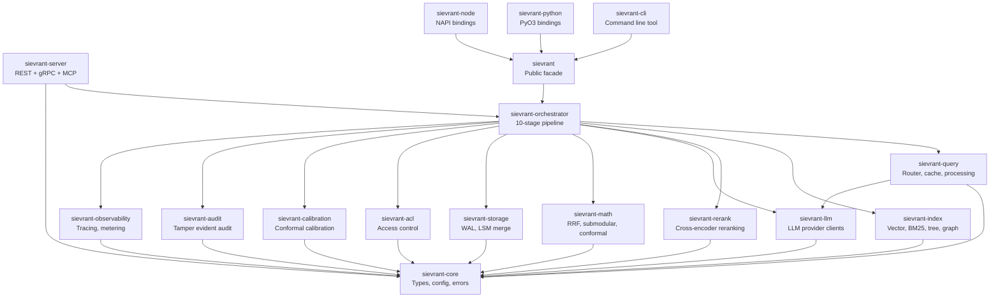
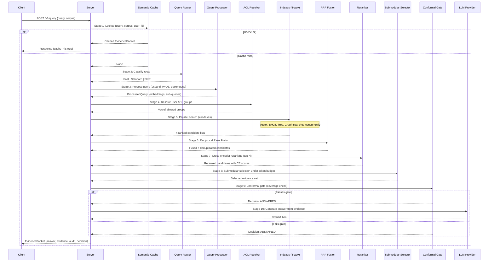
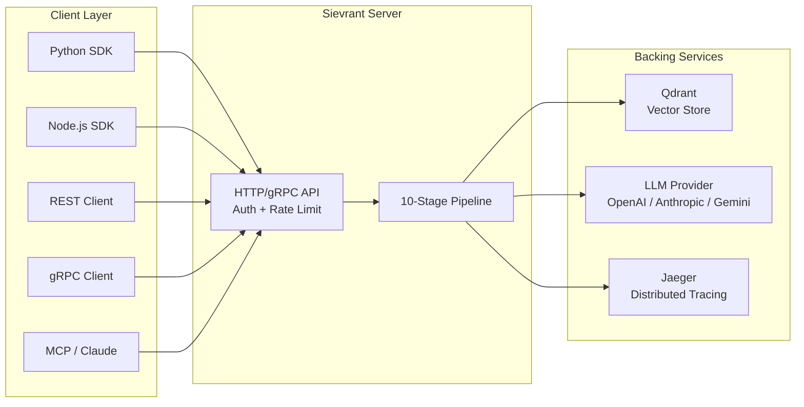

# Sievrant Architecture

This document provides a technical overview of Sievrant's internal architecture, crate dependency graph, and data flow through the retrieval pipeline.

## Crate Dependency Graph

The workspace is organized into 17 crates, each with a single responsibility.
Dependencies flow downward: leaf crates at the top, foundational crates at the bottom.



## Data Flow: Single Query

The following sequence diagram shows how a single query flows through all 10 stages of the retrieval pipeline. Each stage either transforms or filters the data before passing it to the next.



## Mathematical Foundations

Sievrant replaces LLM heuristics with mathematically grounded decision mechanisms at three critical points in the pipeline.

### Reciprocal Rank Fusion (Stage 6)

RRF combines ranked lists from heterogeneous retrieval systems without requiring score calibration. For a document d appearing at rank r in list L, the fused score is:

```
RRF(d) = sum over all lists L of: 1 / (k + rank_L(d))
```

where k is a constant (default 60, per Cormack et al. 2009). This is calibration-free: it works regardless of whether the underlying scores are probabilities, cosine similarities, or BM25 values.

### Submodular Evidence Selection (Stage 8)

Given a token budget B, selecting the optimal subset of evidence chunks is NP-hard. Sievrant uses the greedy algorithm for monotone submodular maximization, which provides a (1 minus 1/e) approximation guarantee (Nemhauser et al. 1978). The objective function balances relevance (reranker score) against redundancy (pairwise similarity between selected chunks).

### Conformal Prediction Gate (Stage 9)

The conformal gate provides distribution-free finite-sample coverage guarantees. Given a calibration set and a target coverage level alpha (default 0.95), the gate computes a threshold such that at least alpha fraction of future correct answers will pass the gate. This guarantee holds regardless of the underlying score distribution, requiring only the exchangeability assumption.

## Deployment Topology


