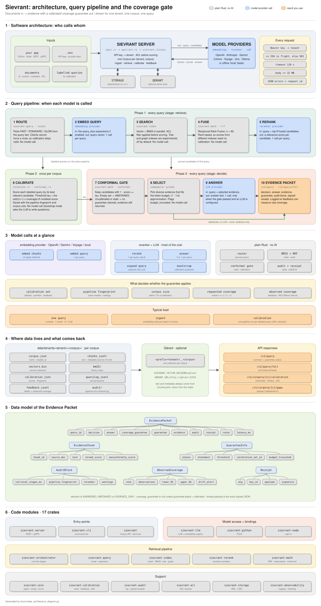

# Sievrant

**Retrieval with a calibrated, testable coverage guarantee.**

[](LICENSE)
[](https://www.rust-lang.org)

Sievrant sits between your documents and your LLM or agent. You send it a
question. It returns the evidence passages, an answer (optional), and a
machine-readable statement of **how much you can trust that evidence**. When
nothing in the corpus clears the calibrated threshold, it **abstains** instead
of guessing.

It is not a vector database and not an agent framework. It is the decision
layer between the two, written in Rust, served over REST (and gRPC).



<sub>Diagram source: [`docs/make_architecture_diagram.py`](docs/make_architecture_diagram.py) (standard-library Python; re-run it after changing the pipeline).</sub>

---

## The guarantee, precisely

After you calibrate a corpus with labelled example queries:

> For a new answerable query that resembles the calibration queries, the
> evidence set Sievrant returns contains at least one relevant passage with
> probability at least the requested coverage (e.g. 95%).

This is split conformal prediction (Vovk et al. 2005; Angelopoulos & Bates 2021).

| It guarantees | It does **not** guarantee |
|---|---|
| A relevant passage is in the evidence set, at the requested rate | That the LLM's answer is correct or hallucination-free |
| Abstention on at most `1 - coverage` of answerable queries | Abstention on out-of-scope queries (measured, not bounded) |
| Detection when the pipeline or corpus changes since calibration | Anything if real traffic looks different from the calibration queries |

Every response says whether the guarantee applies:

```json
{ "coverage_guarantee": 0.95, "guarantee_status": "calibrated" }
{ "coverage_guarantee": null, "guarantee_status": "uncalibrated" }
```

`guarantee_status` is one of `calibrated`, `uncalibrated`, `insufficient_data`,
`unachievable`, `stale` or `degraded`. Only `calibrated` comes with a number.

**How many calibration queries?** The minimum is 20, but the guarantee holds
*on average over calibration sets*. With 20 labelled queries, about 1 in 8
deployments delivers under 90% while targeting 95%. With 200 that drops to
about 1 in 250. **Use 200+ labelled queries for anything you advertise.**
Details: [docs/DEPLOYMENT_REVIEW.md](docs/DEPLOYMENT_REVIEW.md#statistics-what-holds-and-what-would-make-it-better).

---

## How a query flows

| Step | What happens | Model call? |
|---|---|---|
| 1. Route | Picks FAST / STANDARD / SLOW from the query text | no |
| 2. Embed query | Query (and optional expansions) to a vector | embedding provider |
| 3. Search | Vector + BM25 in parallel; ACL filter applied **before** scoring | no |
| 4. Fuse | Reciprocal Rank Fusion (k = 60) | no |
| 5. Rerank | Relevance score for the top-N candidates | reranker provider |
| 6. Conformal gate | Keep candidates whose nonconformity ≤ calibrated τ; empty → `ABSTAINED` | no |
| 7. Select | Submodular greedy selection under the token budget | no |
| 8. Answer | Answer from the selected evidence (only if the gate passed) | LLM (optional) |
| 9. Evidence Packet | Decision, evidence, guarantee, audit block, signed receipt | no |

Calibration runs steps 1–5 on each labelled query and stores the threshold
with a fingerprint of the pipeline, so a changed model or setting is detected
(`stale`) instead of silently voiding the guarantee.

---

## Quick start (Docker)

```bash
git clone https://github.com/Nabarup1/sievrant
cd sievrant
cp .env.example .env
```

Edit `.env` and set at least:

```bash
SIEVRANT_API_KEYS=mytenant:<paste output of: openssl rand -hex 32>
OPENAI_API_KEY=sk-...        # or ANTHROPIC_/GEMINI_/COHERE_/VOYAGE_ keys; see .env.example
```

Then:

```bash
docker compose up -d --build
curl http://localhost:8080/v1/health
# {"status":"ok","version":"0.1.0"}
```

The server **refuses to start** without an API key, with a key shorter than 16
characters, or with a placeholder copied from an example file.

## Quick start (local, no Docker, no API keys)

Runs fully offline with the built-in `local` embedder. Good for trying the API,
not for real retrieval quality.

```bash
export SIEVRANT_API_KEYS="dev:$(openssl rand -hex 24)"
export SIEVRANT_LLM_PROVIDER=none SIEVRANT_EMBEDDING_PROVIDER=local SIEVRANT_RERANKER_PROVIDER=embedding
cargo run --release -p sievrant-server
```

---

## Using the API

```bash
KEY=<your key>   # the part after "mytenant:"
H=(-H "Authorization: Bearer $KEY" -H "Content-Type: application/json")

# 1. Ingest (creates the corpus)
curl -s localhost:8080/v1/ingest "${H[@]}" -d '{
  "corpus": "contracts",
  "documents": [{"id": "lease-001",
                 "content": "The lease term is 60 months starting January 1, 2025...",
                 "metadata": {"title": "Office lease"},
                 "acl_groups": ["legal"]}]}'

# 2. Query
curl -s localhost:8080/v1/query "${H[@]}" -d '{
  "corpus": "contracts", "query": "How long is the lease?", "acl_groups": ["legal"]}'

# 3. Calibrate once (20 minimum, 200+ recommended). Empty id lists = unanswerable query.
curl -s localhost:8080/v1/calibration "${H[@]}" -d '{
  "corpus": "contracts",
  "examples": [{"query": "How long is the lease?", "relevant_doc_ids": ["lease-001"]}, ...]}'

# 4. Report what was actually relevant (feeds observed-coverage monitoring)
curl -s localhost:8080/v1/feedback "${H[@]}" -d '{
  "corpus": "contracts", "query_id": "<from step 2>", "relevant_doc_ids": ["lease-001"]}'
```

No labels yet? `POST /v1/calibration/bootstrap {"corpus": "contracts", "n": 200}`
has the LLM write questions from your documents (marked `synthetic`; it assumes
real traffic resembles them).

### Endpoints

Interactive docs: `http://localhost:8080/swagger-ui`.

| Method | Path | Purpose |
|---|---|---|
| GET | `/v1/health` | Liveness (no auth) |
| POST | `/v1/query` | Answer + summary with `guarantee_status` |
| POST | `/v1/query/full` | Full Evidence Packet (evidence, audit, guarantee, receipt) |
| POST | `/v1/search` | Ranked candidates, no gate, no answer |
| POST | `/v1/ingest` | Add or replace documents |
| DELETE | `/v1/corpora/{corpus}/documents/{doc_id}` | Delete a document everywhere |
| GET | `/v1/corpora` · `/v1/corpora/{corpus}` | List corpora / stats |
| GET | `/v1/corpora/{corpus}/documents` | Page through documents |
| GET | `/v1/corpora/{corpus}/calibration` | Thresholds, held-out check, observed coverage, drift |
| GET | `/v1/corpora/{corpus}/gaps` | Queries the corpus could not answer |
| POST | `/v1/calibration` · `/bootstrap` · `/feedback` | Calibrate from labels, LLM questions, or feedback |
| POST | `/v1/feedback` | Label a served query |
| GET | `/v1/info` | Active providers (no secrets) and your tenant |

Each API key belongs to one tenant, and a tenant only sees its own corpora.
`acl_groups` on a query should be the **end user's** groups. Your backend is
trusted to pass them.

### SDKs

```python
# pip install ./sdks/python
from sievrant import SievrantClient

async with SievrantClient(base_url="http://localhost:8080", api_key=KEY) as client:
    await client.ingest(corpus="contracts", documents=[{"id": "lease-001", "content": "..."}])
    r = await client.query(corpus="contracts", query="How long is the lease?")
    print(r.decision, r.coverage_guarantee, r.guarantee_status)
```

```typescript
// sdks/nodejs: see its README to build (`npm run build` also compiles a Rust native addon)
import { SievrantClient } from 'sievrant';
const client = new SievrantClient({ baseUrl: 'http://localhost:8080', apiKey: KEY });
const r = await client.query({ corpus: 'contracts', query: 'How long is the lease?' });
console.log(r.decision, r.coverage_guarantee);
```

Both SDKs also read `SIEVRANT_BASE_URL` and `SIEVRANT_API_KEY` from the
environment. Python integrations for LangChain, LlamaIndex and DSPy are in
`sdks/python/sievrant/integrations/`.

### Embedded in Rust

See [`crates/sievrant/examples/quickstart.rs`](crates/sievrant/examples/quickstart.rs):

```rust
let corpus = Corpus::create("contracts", SievrantConfig::load()?).await?;
corpus.ingest(vec![Document { id: "lease-001".into(), content: "...".into(),
                              metadata: Default::default(), acl_groups: vec![] }]).await?;
let packet = corpus.retrieve("How long is the lease?",
                             RetrievalConfig { coverage: 0.95, ..Default::default() }).await?;
println!("{:?} {:?}", packet.decision, packet.coverage_guarantee);
```

```bash
cargo run -p sievrant --example quickstart
```

---

## Configuration

Everything is set through environment variables (or an optional
`sievrant.toml`). Nothing is hard-coded: defaults are listed in
[`.env.example`](.env.example) and [`crates/sievrant-core/src/config.rs`](crates/sievrant-core/src/config.rs).

| Variable | Default | Meaning |
|---|---|---|
| `SIEVRANT_API_KEYS` | none, **required** | `tenant:key,tenant:key` (or `SIEVRANT_API_KEY`, `SIEVRANT_API_KEY_HASHES`) |
| `SIEVRANT_HOST` / `SIEVRANT_PORT` | `0.0.0.0` / `8080` | REST listen address |
| `SIEVRANT_GRPC_ENABLED` / `SIEVRANT_GRPC_PORT` | `true` / `50051` | gRPC (Retrieve, Ingest) |
| `SIEVRANT_DATA_DIR` | `data` | Corpora, indexes, calibration |
| `SIEVRANT_LLM_PROVIDER` | `auto` | `auto` picks the first provider with a key; `none` = evidence only |
| `SIEVRANT_EMBEDDING_PROVIDER` | `auto` | Falls back to offline `local` (warns) |
| `SIEVRANT_RERANKER_PROVIDER` | `auto` | `cohere`, `voyage`, `jina`, `custom`, `embedding`, `llm`, `none` |
| `SIEVRANT_VECTOR_BACKEND` | `memory` | `memory` (persisted to disk) or `qdrant` (+ `QDRANT_URL`, gRPC port 6334) |
| `SIEVRANT_DEFAULT_COVERAGE` | `0.95` | Coverage when a request doesn't specify one |
| `SIEVRANT_CORS_ORIGINS` | unset | Browser origins allowed. Unset = no browser access |
| `SIEVRANT_MAX_CONCURRENT_REQUESTS` | `256` | Above this, requests get `503` with `retry-after` |
| `SIEVRANT_MAX_BODY_BYTES` | `33554432` | Request body limit |
| `SIEVRANT_SIGNING_KEY` | unset | Ed25519 key for signed retrieval receipts |
| `SIEVRANT_LOG_FORMAT` / `RUST_LOG` | `json` in Docker | Logging |

## Deploying

- Run **one replica per data volume**. Corpus files use an in-process lock;
  two servers on one volume will corrupt them.
- Terminate TLS in a reverse proxy (Caddy, nginx, a cloud load balancer).
- Use real embedding and reranker providers in production.
- Back up the data volume.

Full checklist and known gaps: [docs/DEPLOYMENT_REVIEW.md](docs/DEPLOYMENT_REVIEW.md).

---

## Status

| Component | Status |
|---|---|
| REST API, multi-tenant API keys, ACL filtering | Shipped |
| Vector (memory / Qdrant) + BM25 retrieval, RRF, reranking | Shipped |
| Conformal gate, calibration (labelled / synthetic / feedback), drift monitoring | Shipped |
| Evidence Packet, audit log, signed receipts | Shipped |
| Python and Node SDKs; LangChain / LlamaIndex / DSPy adapters | Shipped |
| gRPC (`Retrieve`, `Ingest`) | Shipped; `QueryStream` returns `UNIMPLEMENTED` |
| Tree and graph indexes | Experimental (`SIEVRANT_EXPERIMENTAL_INDEXES=true`) |
| Semantic cache | Disabled until it can key on the calibration set |
| Per-key rate limits, OpenTelemetry export, MCP server | Planned |
| Calibration-conditional (PAC) guarantee | Planned (see review) |

---

## Development

Build and test only what you need. The full workspace also builds the
Python/Node native bindings and benchmarks, which is slow and takes a lot of disk.

```bash
cargo test -p sievrant-server -p sievrant -p sievrant-math -p sievrant-calibration -p sievrant-orchestrator
cargo run  -p sievrant-server
python3 docs/make_architecture_diagram.py      # regenerate the README diagram
```

Tips: add `--offline` once dependencies are downloaded, and run `cargo clean`
to reclaim the `target/` folder.

## Benchmarks

Earlier internal numbers (BEIR SciFact subset, 300 queries, single developer
machine) are in [docs/comparison/benchmarks.md](docs/comparison/benchmarks.md),
with scripts in `benchmarks/`. They **predate the current pipeline** and should
be re-run before being quoted.

```bash
cd benchmarks && bash run_beir.sh --dataset scifact --seed 42
```

## Documentation

[Docs index](docs/index.md) · [Quickstart](docs/quickstart.md) ·
[Conformal prediction explained](docs/concepts/conformal-prediction.md) ·
[Architecture](docs/concepts/architecture.md) · [REST API](docs/api-reference/rest-api.md) ·
[Python SDK](docs/guides/python-sdk.md) · [Node SDK](docs/guides/nodejs-sdk.md) ·
[Rust SDK](docs/guides/rust-sdk.md) · [Docker](docs/guides/docker-compose.md) ·
[Deployment review](docs/DEPLOYMENT_REVIEW.md)

## Contributing · Security · License

See [CONTRIBUTING.md](CONTRIBUTING.md) and [SECURITY.md](SECURITY.md).
Apache 2.0. See [LICENSE](LICENSE).
