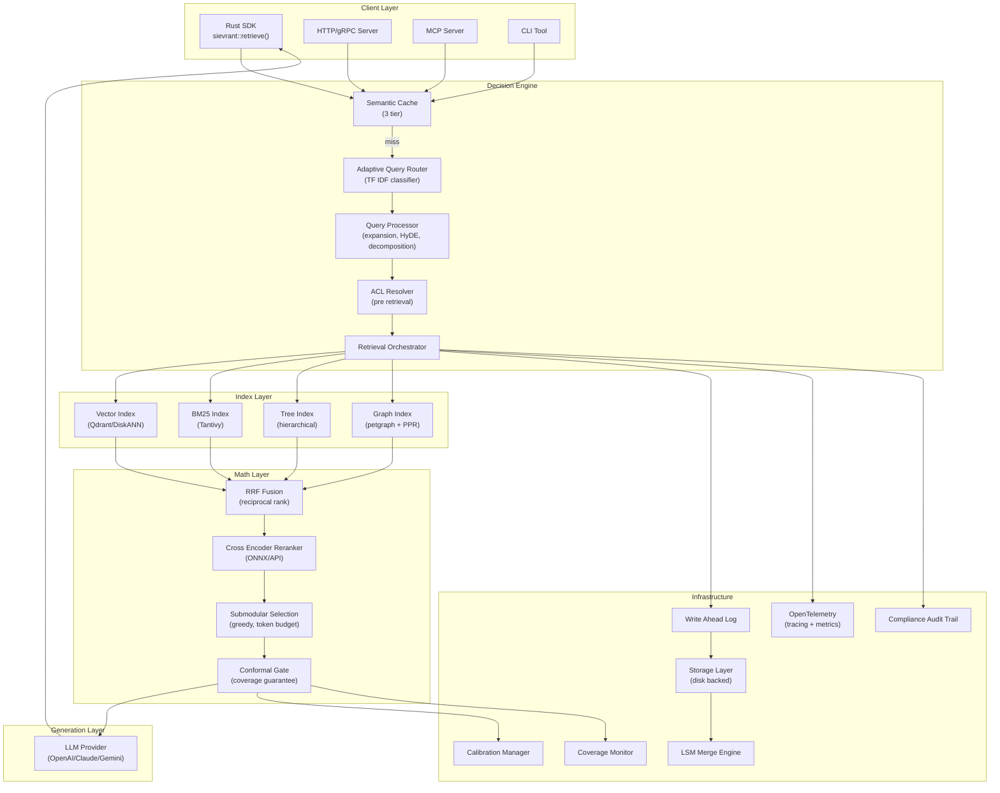
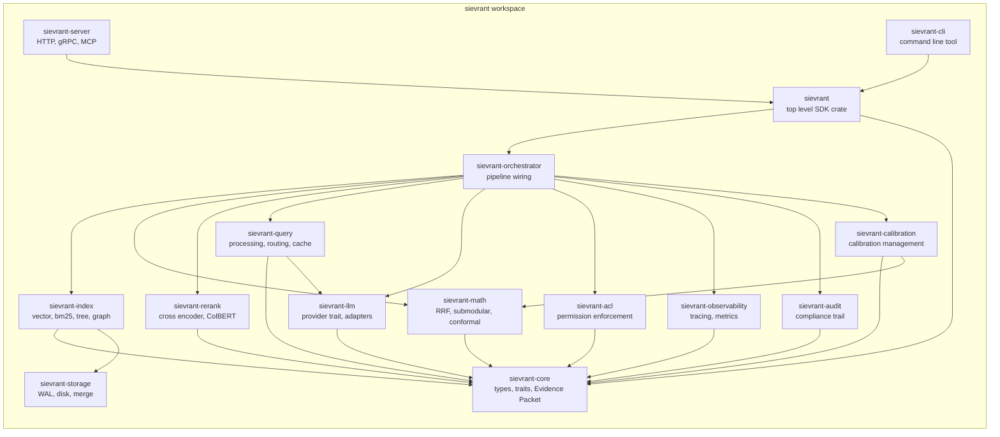
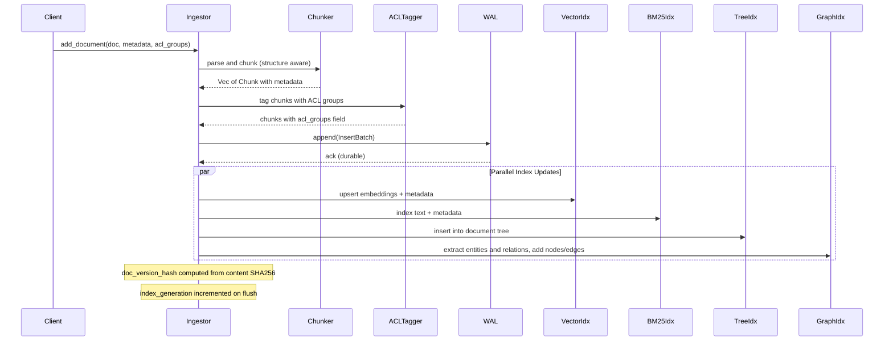
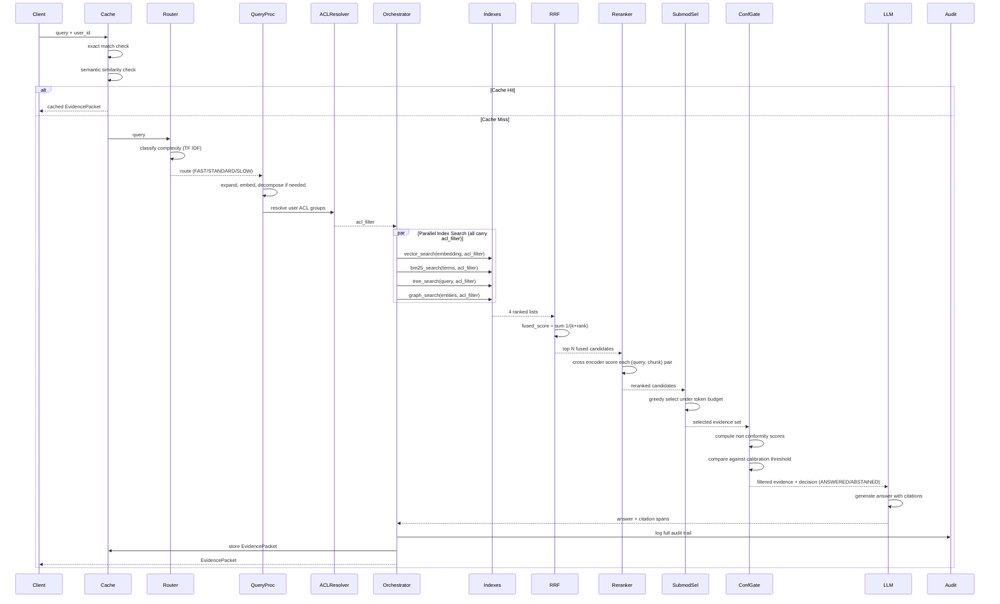
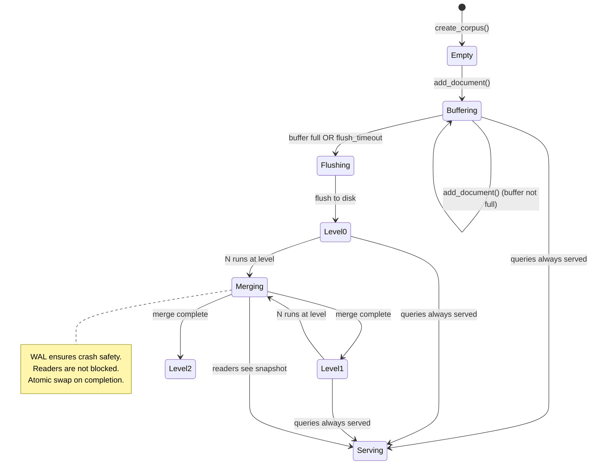
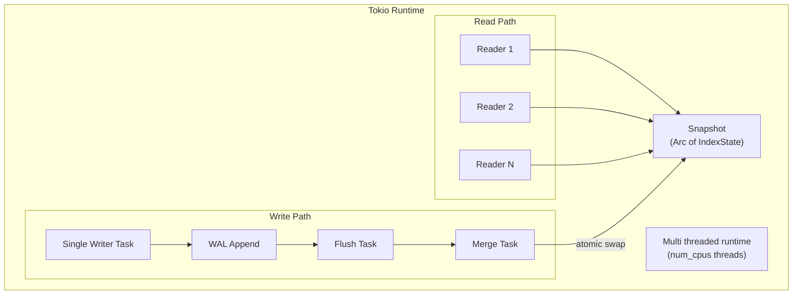
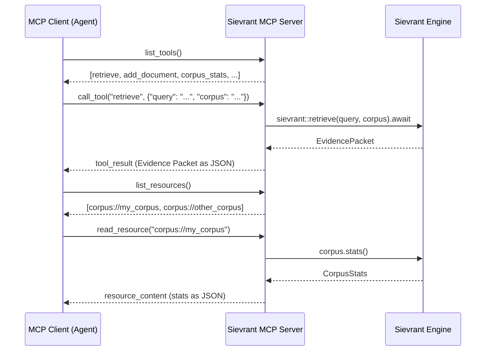
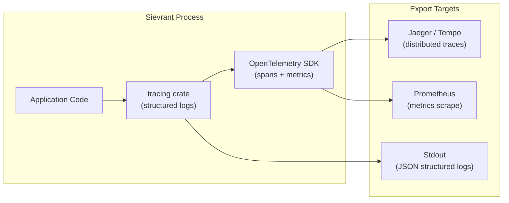
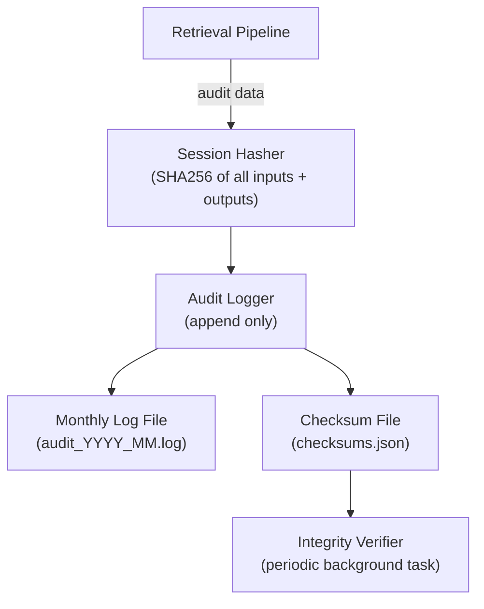

# Sievrant: System Architecture

**Version**: 1.0
**Date**: August 30, 2026
**Status**: Draft

---

## 1. High Level Architecture



---

## 2. Crate Workspace Topology

The project is organized as a Cargo workspace with focused crates. Each crate has a single responsibility and minimal coupling to others.



### 2.1 Crate Descriptions

| Crate | Path | Purpose |
|---|---|---|
| `sievrant-core` | `crates/sievrant-core` | Domain types: EvidencePacket, ChunkMetadata, QueryId, Decision, Route, errors |
| `sievrant-index` | `crates/sievrant-index` | All four index implementations (vector, bm25, tree, graph) |
| `sievrant-math` | `crates/sievrant-math` | RRF fusion, submodular selection, conformal gate |
| `sievrant-rerank` | `crates/sievrant-rerank` | Cross encoder and ColBERT reranking |
| `sievrant-query` | `crates/sievrant-query` | Query processing, HyDE, decomposition, adaptive routing, semantic cache |
| `sievrant-llm` | `crates/sievrant-llm` | LlmProvider trait and all provider adapters |
| `sievrant-orchestrator` | `crates/sievrant-orchestrator` | Main retrieve() pipeline, stage wiring |
| `sievrant-storage` | `crates/sievrant-storage` | WAL, disk persistence, LSM merge engine |
| `sievrant-acl` | `crates/sievrant-acl` | Permission aware access control, ACL metadata filtering |
| `sievrant-observability` | `crates/sievrant-observability` | OpenTelemetry integration, span definitions, metrics |
| `sievrant-audit` | `crates/sievrant-audit` | Compliance audit trail, tamper evident logging, session hashing |
| `sievrant-calibration` | `crates/sievrant-calibration` | Calibration set management, threshold computation, monitoring |
| `sievrant-server` | `crates/sievrant-server` | HTTP/gRPC server and MCP server implementation |
| `sievrant-cli` | `crates/sievrant-cli` | Command line tool for corpus management, queries, benchmarks |
| `sievrant` | `crates/sievrant` | Top level SDK crate, re exports, one line API |

---

## 3. Data Flow Diagrams

### 3.1 Ingestion Flow



### 3.2 Retrieval Flow (Full Pipeline)



---

## 4. Evidence Packet Schema (JSON Schema)

```json
{
  "$schema": "http://json-schema.org/draft-07/schema#",
  "title": "EvidencePacket",
  "type": "object",
  "required": ["query_id", "decision", "coverage_guarantee", "evidence", "latency_ms"],
  "properties": {
    "query_id": { "type": "string", "description": "Unique identifier for this retrieval request" },
    "trace_id": { "type": "string", "description": "OpenTelemetry trace ID for correlation" },
    "answer": { "type": ["string", "null"], "description": "Generated answer, null if ABSTAINED or EVIDENCE_ONLY" },
    "decision": {
      "type": "string",
      "enum": ["ANSWERED", "ABSTAINED", "EVIDENCE_ONLY"],
      "description": "Retrieval outcome"
    },
    "coverage_guarantee": { "type": "number", "minimum": 0, "maximum": 1 },
    "empirical_coverage_last_30d": { "type": ["number", "null"], "minimum": 0, "maximum": 1 },
    "route": { "type": "string", "enum": ["FAST", "STANDARD", "SLOW", "CACHED"] },
    "cache_hit": { "type": "boolean" },
    "evidence": {
      "type": "array",
      "items": {
        "type": "object",
        "required": ["chunk_id", "source_doc", "doc_version_hash"],
        "properties": {
          "chunk_id": { "type": "string" },
          "source_doc": { "type": "string" },
          "doc_version_hash": { "type": "string" },
          "path": { "type": "array", "items": { "type": "string" } },
          "page": { "type": ["integer", "null"] },
          "char_span": { "type": "array", "items": { "type": "integer" }, "minItems": 2, "maxItems": 2 },
          "retriever": { "type": "string" },
          "rrf_score": { "type": "number" },
          "rerank_score": { "type": ["number", "null"] },
          "nonconformity_score": { "type": "number" },
          "submodular_marginal_gain": { "type": "number" },
          "ingested_at": { "type": "string", "format": "date-time" },
          "index_generation": { "type": "integer" },
          "acl_groups": { "type": "array", "items": { "type": "string" } },
          "freshness_hours": { "type": "number" }
        }
      }
    },
    "audit": {
      "type": "object",
      "properties": {
        "model_version": { "type": "string" },
        "retrieval_stages_ms": { "type": "object" },
        "total_candidates_before_rerank": { "type": "integer" },
        "total_candidates_after_rerank": { "type": "integer" },
        "total_candidates_after_conformal": { "type": "integer" },
        "calibration_set_id": { "type": "string" },
        "session_hash": { "type": "string" }
      }
    },
    "latency_ms": { "type": "integer" },
    "cost_usd": { "type": ["number", "null"] }
  }
}
```

---

## 5. Index Lifecycle

### 5.1 State Machine



### 5.2 Merge Strategy

- Level 0: in memory buffer, max 10K chunks
- Level 1: on disk sorted runs, merge when 10 runs accumulate
- Level 2: larger merged files, merge when 5 runs accumulate
- Each merge produces a single run at the next level
- Old runs are deleted only after the new run is fully written and verified

---

## 6. Concurrency Model



### 6.1 Key Properties

- **No global locks on read path**: Readers acquire an Arc clone of the current index state snapshot
- **Single writer serialization**: All mutations go through a single writer task via an mpsc channel
- **Atomic snapshot swap**: When a merge completes, the new index state is published via Arc swap (using arc_swap crate or similar)
- **Background tasks**: Merge and flush run as spawned tokio tasks, not blocking the main request handling

---

## 7. API Surface Design

### 7.1 The One Liner (Default Path)

```rust
// Everything behind this call: cache check, routing, 4 index search,
// RRF fusion, reranking, submodular selection, conformal gate, LLM generation
let packet = sievrant::retrieve("What is the lease term?", &corpus).await?;
```

### 7.2 The Builder (Tunable Path)

```rust
let packet = sievrant::retrieve("What is the lease term?", &corpus)
    .coverage(0.95)           // conformal coverage target
    .budget(4000)             // max tokens for evidence context
    .route(Route::Auto)       // or Route::Fast, Route::Slow
    .llm(Provider::Claude)    // LLM for generation
    .user("user_123")         // for ACL resolution
    .skip_cache(false)        // use cache if available
    .await?;
```

### 7.3 Evidence Only (No LLM Generation)

```rust
let packet = sievrant::evidence("What is the lease term?", &corpus)
    .coverage(0.95)
    .budget(4000)
    .user("user_123")
    .await?;
// packet.decision will be EVIDENCE_ONLY
// packet.answer will be None
// packet.evidence will contain the selected chunks
```

### 7.4 Corpus Management

```rust
// Create a corpus
let corpus = sievrant::Corpus::create("my_corpus", config).await?;

// Add documents
corpus.add_document(doc, metadata, acl_groups).await?;

// Bulk ingest
corpus.ingest_batch(documents).await?;

// Force flush
corpus.flush().await?;

// Get corpus stats
let stats = corpus.stats().await?;
```

---

## 8. MCP Server Architecture



### 8.1 MCP Tools Exposed

| Tool | Description | Parameters |
|---|---|---|
| `retrieve` | Full retrieval with Evidence Packet | query, corpus, coverage, budget, user |
| `evidence` | Evidence only, no LLM generation | query, corpus, coverage, budget, user |
| `add_document` | Ingest a document into a corpus | corpus, content, metadata, acl_groups |
| `corpus_stats` | Get corpus statistics | corpus |
| `list_corpora` | List available corpora | none |
| `calibration_status` | Check calibration coverage status | corpus |

### 8.2 MCP Resources Exposed

| Resource | Description |
|---|---|
| `corpus://{name}` | Corpus metadata and statistics |
| `calibration://{corpus}` | Current calibration status and coverage metrics |

---

## 9. Observability Architecture



### 9.1 Span Tree for a Single Retrieval

```
sievrant.retrieve (root span)
  |-- sievrant.cache.check
  |-- sievrant.query.route
  |-- sievrant.query.process
  |   |-- sievrant.query.expand (LLM call)
  |   |-- sievrant.query.embed
  |-- sievrant.acl.resolve
  |-- sievrant.index.search (parallel children)
  |   |-- sievrant.index.vector
  |   |-- sievrant.index.bm25
  |   |-- sievrant.index.tree
  |   |-- sievrant.index.graph
  |-- sievrant.math.rrf
  |-- sievrant.rerank
  |-- sievrant.math.submodular
  |-- sievrant.math.conformal
  |-- sievrant.llm.generate
  |-- sievrant.cache.store
  |-- sievrant.audit.log
```

### 9.2 Key Metrics

| Metric | Type | Labels |
|---|---|---|
| `sievrant_retrieve_duration_seconds` | Histogram | route, decision, corpus |
| `sievrant_retrieve_total` | Counter | route, decision, corpus |
| `sievrant_cache_hit_total` | Counter | hit_type (exact, semantic, miss) |
| `sievrant_coverage_empirical` | Gauge | corpus, calibration_set |
| `sievrant_index_search_duration_seconds` | Histogram | index_type |
| `sievrant_rerank_duration_seconds` | Histogram | reranker_type |
| `sievrant_evidence_count` | Histogram | route |
| `sievrant_token_budget_utilization` | Histogram | route |
| `sievrant_corpus_document_count` | Gauge | corpus |
| `sievrant_merge_duration_seconds` | Histogram | level |

---

## 10. Compliance Architecture

### 10.1 Audit Trail Design

Every retrieval produces an audit record stored in append only log files with periodic integrity checksums.



### 10.2 EU AI Act Mapping

| Article | Requirement | Sievrant Implementation |
|---|---|---|
| Article 9 | Risk management system | Coverage monitoring, drift detection, recalibration triggers |
| Article 10 | Data governance | doc_version_hash, ingested_at, index_generation tracking |
| Article 11 | Technical documentation | Evidence Packet schema, system architecture docs, calibration set documentation |
| Article 12 | Record keeping | Immutable audit trail with session hashing, per stage timing, model version |
| Article 13 | Transparency | Evidence Packet exposes all retrieval decisions, scores, and metadata to consumers |
| Article 14 | Human oversight | decision field (ANSWERED/ABSTAINED) enables human review workflows |
| Article 15 | Accuracy, robustness, cybersecurity | Conformal coverage guarantee, WAL crash safety, pre retrieval ACL enforcement |

---

## 11. Research Track (Excluded from Core)

These components are architecturally interesting but require LLM as simulator with thousands of rollouts, which is not productizable today. They live in an optional `sievrant-research` crate.

| Component | What it does | Why it is excluded |
|---|---|---|
| POMCP / PO UCT planning | Optimizes retrieval strategy as a partially observable Markov decision process | Needs LLM rollout simulator, not real time |
| Particle filter belief tracking | Maintains probabilistic belief state during multi hop retrieval | Computationally expensive, unclear production benefit |
| Query conditioned dynamic PPR reweighting | Adapts graph edge weights per query at inference time | Requires per query graph computation, latency prohibitive |

These can be activated experimentally via feature flags but are not part of the default pipeline.
